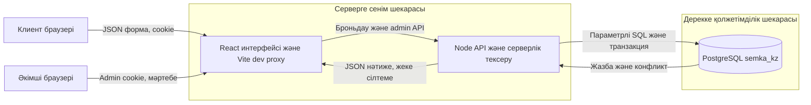

# Съёмка kz Броньдау компонентінің STRIDE моделі

16.10.2026. Иесі: Ерденбаев Адильжан. UI және құпиялық review: Айтказинов Арсен. Мәртебе: алғашқы модель; Threat Dragon экспорты әзірге жасалған жоқ.

## Шекара және активтер

Қарастырылатын ағын: пайдаланушы локация таңдайды, уақыт пен контакт енгізеді, API өтінімді PostgreSQL-де сақтайды, әкімші мәртебені өзгертеді. Активтер: бронь тұтастығы, клиент байланыстары, сессиялар, пароль хештері және аудит. Локациялар әзірге server/locations.mjs ішінде; PostgreSQL-де локациялар кестесі жоқ.

Локалды HTTP/localhost және sslmode=disable қолданылады. Бұл сыртқы production тасымалын қорғау дәлелі емес. Өндірістік шекарада HTTPS және тексерілген DB TLS қажет; қазіргі localhost параметрлері сыртқа тікелей көшірілмейді.

## Алты STRIDE категориясы

| ID | Категория | Нысана және сценарий | Қорғаныс/шара | Мәртебе | Иесі | Дәлел |
|---|---|---|---|---|---|---|
| T01 | S Spoofing | Құпиясөзді не кодты шексіз тексеріп өзгенің аккаунтына кіру | Санағышты қателік transaction-ынан бөлу; 429 Retry-After; user/IP шектері | Ашық SEC-01 | Адильжан | auth-observations.json |
| T02 | T Tampering | Клиент баға/уақытты өзгертіп не бір слотқа қатар өтінім жіберу | Бағаны серверде есептеу, параметрлі SQL, inventory lock, idempotency | Бар; броньдау тесттері өткен | Адильжан | tests/api.test.mjs, tests/postgres.test.mjs |
| T03 | R Repudiation | Әкімші өтінімді өзгерткенін жоққа шығарады | audit бар; жеке admin identity мен read-access аудитін қосу | Ішінара; shared admin actor ажыратылмайды | Адильжан | audit кестесі, admin session моделі |
| T04 | I Information disclosure | Рұқсатсыз API-дан телефон, email немесе пароль хешін алу | Public receipt контактты жасырған; admin guard; жергілікті .env; UI-дегі минималды дерек | Ішінара; саясат пен retention ашық | Арсен | public receipt тесті, SEC-03 |
| T05 | D Denial of service | Көп тіркеу/scrypt сұрауы event loop-ты жүктейді | Register/user/IP лимиті; дене өлшемі; timeout; асинхронды хештеу жоспары | Дене/timeout бар; register лимиті жоқ | Адильжан | app.mjs jsonBody және register |
| T06 | E Elevation of privilege | Клиент өзіне admin рөлін береді немесе studio owner API ашады | Рөл register SQL-де client ретінде бекітілген; admin cookie бөлек; owner мүмкіндігі әлі жоқ | Ішінара; role regression тесті қажет | Адильжан | users CHECK және admin guard |

## Threat Dragon-да аяқтау

Осы модель бойынша external entity ретінде клиент пен әкімшіні, process ретінде API-ды, datastore ретінде PostgreSQL-ді құру керек. Браузер–API және API–DB шекараларын белгілеу; T01–T06 әрқайсын тиісті элемент/ағынға қосу; күйін және шарасын көшіру. Экспорт орындалғанға дейін бұл Markdown моделін Threat Dragon JSON деп атауға болмайды.

Әдіс көзі: [OWASP Threat Modeling Process](https://owasp.org/www-community/Threat_Modeling_Process), қаралған күні 16.10.2026. Бұл әдістемелік негіз; жобаның қауіпсіздік сертификаты емес.
